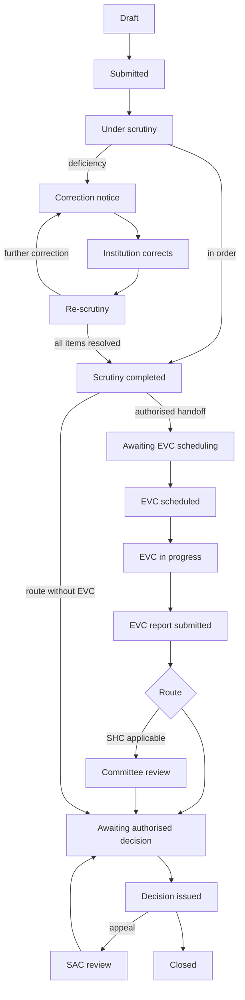

# AICTE Approval Portal

**Smart India Hackathon 2025 · Problem Statement SIH26262** — an integrated platform for end-to-end automation and monitoring of AICTE approval workflows and institutional compliance.

The portal takes an institution's application from draft through scrutiny, re-scrutiny, the Expert Visit Committee (EVC), committee review and the authorised decision, and keeps monitoring undertakings, document validity and deadlines afterwards. Every stage has a role-specific dashboard, every action is reasoned and recorded, and every regulatory check is a deterministic rule traced to the AICTE Approval Process Handbook (APH) 2024-27.

**Design principle: automate the process, not the statutory decision.** The software validates, routes, schedules, notifies, reminds and escalates. Approvals, deficiencies and decisions are always recorded by an authorised official, never by the software or an AI model.

## Contents

- [Features](#features)
- [Tech stack](#tech-stack)
- [Quick start](#quick-start)
- [Database: Supabase or embedded](#database-supabase-or-embedded)
- [Deployment](#deployment)
- [Demo accounts](#demo-accounts)
- [Application workflow](#application-workflow)
- [Rules engine](#rules-engine)
- [Project structure](#project-structure)
- [Scripts](#scripts)
- [Tests](#tests)
- [Recorded demo](#recorded-demo)
- [Security](#security)
- [Known limitations](#known-limitations)

## Features

**Institution portal**
- Catalogue of 22 application types from the APH; choosing a type (and sub-type) loads only the fields and documents that apply
- Guided three-step application with required-field enforcement, repeatable course tables and draft auto-save
- Document checklist with content-type checks (PDF / JPG / PNG, 10 MB), SHA-256 fingerprints, version history and a mandatory DSC declaration
- Pre-submission validation against the rules engine, then a declared, locked submission with a server-issued reference (`FG-YYYYYY-NNNNNN`)
- Tracking: stage tracker, shared workflow history, correction notices, guided item-by-item responses, EVC visits, decisions, appeals (once, within the window) and compliance obligations
- In-app notifications for every stage change

**AICTE officials**
- **Scrutiny** — review queue with assignment locking, automated checks report (rule IDs and verdicts), per-document examination records, and two decisions: *Send for re-scrutiny* (reasoned correction notice) or *Forward to the EVC coordinator / decision stage*
- **Re-scrutiny** — only the notice items are re-checked; original notice and institution response side by side; item outcomes recorded before the review is submitted; authorised EVC handoff after an eligibility check
- **EVC scheduling (Regional Officer)** — week calendar, live availability of every registry expert, "Fill vacant seats" with verified, eligible officials, Annexure 16 §16.5 committee composition checks, alternative slots, invitations that reserve each member's time, confirmation only after every member accepts, reschedule and cancel with history
- **EVC members** — accept, decline or report a conflict; record unavailability; start the visit, record attendance, upload the inspection report and evidence, write a sectioned report and submit it with a receipt
- **Committees** — case files for the Executive Committee, SHC, SAC and Council; the EC (or Council on appeal) records the decision with the signed letter
- **Regulation Bureau** — escalation queue for missed visits, overdue reports, unacknowledged assignments and unresolved conflicts
- **Supervisor and admin** — oversight, (re)assignment, verification requests, notification delivery and background jobs, operational settings (proposed by an admin, authorised by a supervisor)
- **Reports** — region- and role-scoped pendency report with filters and audited CSV export
- **Rules governance** — rule lifecycle with a verifier and a separate approver

**Monitoring**
- Background sweep every 5 minutes: reminders before deadlines, overdue notices, escalation to the supervisor, retries of failed notifications
- Compliance obligations created from decisions (undertakings, lease renewal with a long reminder ladder) with evidence submission and review
- Document validity tracked only where the APH defines a validity rule
- Append-only audit trail and workflow history, enforced by database triggers

## Tech stack

| Layer | Technology |
|---|---|
| Frontend | React 19, TypeScript, Vite 6, Tailwind CSS 4, React Router 7, Lucide icons |
| Backend | Node.js, Express 4, TypeScript (run with `tsx`), Zod validation, Multer uploads, PDFKit (notices, reports, letters) |
| Database | PostgreSQL — Supabase in deployment, embedded PGlite for local development and tests |
| Core logic | Deterministic rules engine, workflow state machine, EVC composition validator, deadline/obligation scheduler |
| Testing | Vitest, Supertest; Playwright for the recorded demo |

The API and the UI are served from one Express process on one port.

## Quick start

Prerequisites: Node.js 20 or later.

```bash
cd flowguard
npm install
cp .env.example .env      # then edit as needed
npm run dev
```

Open http://localhost:3000. On start the server applies any pending migrations (`server/db/migrations/001`–`010`), and, unless `SEED_DEMO=false`, seeds two demo institutions, the test accounts below, demo EVC registry experts and the rule versions derived from the catalogue. No applications or statistics are seeded: dashboards show only what you create.

For a production build:

```bash
npm run build     # builds the UI into dist/
npm start         # NODE_ENV=production: serves dist/ and enables Secure cookies
```

## Database: Supabase or embedded

Configured in `.env`:

| Variable | Purpose |
|---|---|
| `DATABASE_URL` | Postgres connection string. Leave empty to use the embedded PGlite database |
| `PGLITE_DATA_DIR` | Where the embedded database is stored (default `./data/pgdata`) |
| `STORAGE_DIR` | Private document storage (default `./data/storage`); never served statically |
| `SEED_DEMO` | `false` disables demo institutions and test accounts |
| `PORT` | HTTP port (default 3000) |
| `TRUST_PROXY` | Number of proxy hops in front of the app (usually `1` on a host) so rate limits see the real client IP |
| `SWEEP_INTERVAL_MS`, `ESCALATE_AFTER_OVERDUE_DAYS`, `DISABLE_SCHEDULER` | Background sweep settings (system policy, not APH) |

**Supabase:** use the **Session pooler** connection string (Project Settings → Database → Connect → Session pooler, port 5432). The direct `db.<ref>.supabase.co` host is IPv6-only and fails on IPv4 networks. SSL is enabled automatically for `supabase.com` hosts. Pick the region closest to your users (the reference deployment uses Mumbai, `ap-south-1`). After the first start, run `supabase/rls.sql` in the SQL editor: it enables row-level security and revokes the `anon` / `authenticated` roles on every table, so data is reachable only through this API. Re-run it after migrations that add tables.

`npm run db:reset` deletes the **local** embedded database and storage only; it refuses to run when `DATABASE_URL` is set.

## Deployment

The app is one Node.js service (API and UI on one port) that lives in the `flowguard/` folder of the repository. Any Node host works (Render, Railway, a VM or a container).

| Setting | Value |
|---|---|
| Root directory | `flowguard` |
| Node version | 20 or later (`engines` in `package.json`) |
| Build command | `npm ci && npm run build` |
| Start command | `npm start` |
| Health check | `GET /api/auth/me` (returns 401 when signed out, which means the server is up) |

Environment variables on the host:

| Variable | Value |
|---|---|
| `DATABASE_URL` | Supabase Session pooler connection string |
| `TRUST_PROXY` | `1` (the host's load balancer is one hop) |
| `SEED_DEMO` | `true` for a demo deployment with the test accounts; `false` for real use |
| `STORAGE_DIR` | A path on a persistent disk (see below) |

Do not set `NODE_ENV` on the host: `npm start` sets `production` itself, and setting it during the build makes npm skip the build tools. The host provides `PORT`. Production mode serves the built UI from `dist/`, sets Secure cookies (so the site must be served over HTTPS, which hosts provide) and starts the background sweep; run a single instance so the sweep does not run twice.

**Uploaded documents are stored on the server's disk** (`STORAGE_DIR`). On hosts with an ephemeral filesystem (for example Render's free tier), attach a persistent disk and point `STORAGE_DIR` at it, or uploads are lost on every redeploy. The database itself is in Supabase and is unaffected.

After the first deployment, run `supabase/rls.sql` once in the Supabase SQL editor.

## Demo accounts

Sign in at http://localhost:3000 with any of these accounts. They are seeded for development and demonstration only (defined in `server/db/seed.ts`); set `SEED_DEMO=false` in any real deployment so they are not created.

| Role | Login ID | Password |
|---|---|---|
| Institution applicant — Demo Institute of Technology, Pune | `applicant.demo` | `Applicant@2026` |
| Institution applicant — second institution (tests data isolation) | `applicant.sample` | `Applicant@2026` |
| Scrutiny official | `scrutiny.officer` | `Official@2026` |
| Scrutiny official (second, tests assignment locking) | `scrutiny.officer2` | `Official@2026` |
| Re-scrutiny official | `rescrutiny.officer` | `Official@2026` |
| Regional Officer / EVC coordinator (West demo region) | `regional.officer` | `Official@2026` |
| Regional Officer / EVC coordinator (South demo region) | `regional.officer2` | `Official@2026` |
| EVC member — Academician | `evc.member` | `Official@2026` |
| EVC member — Expert member | `evc.member2` | `Official@2026` |
| EVC member — Architect / Planning | `evc.member3` | `Official@2026` |
| Executive Committee — records first-instance decisions | `ec.official` | `Official@2026` |
| Council — records decisions on appeal | `council.official` | `Official@2026` |
| Standing Hearing Committee | `shc.member` | `Official@2026` |
| Standing Appellate Committee | `sac.member` | `Official@2026` |
| Decision authority — reopen approvals, closing after the appeal window | `decision.authority` | `Official@2026` |
| Regulation Bureau — escalations, expert verification | `regulation.bureau` | `Official@2026` |
| Supervisor — oversight, assignment, verification requests, EVC handoff | `supervisor` | `Official@2026` |
| System administrator — notification delivery, retries, background jobs | `sys.admin` | `Official@2026` |
| Rules governance — rule verifier | `rules.governance` | `Official@2026` |
| Rules governance — second approver | `rules.publisher` | `Official@2026` |

To walk through the main workflow, use them in this order: `applicant.demo` → `scrutiny.officer` → `rescrutiny.officer` → `regional.officer` → `evc.member` / `evc.member2` / `evc.member3` → `regional.officer` → `ec.official`.

Demo regions, registry experts (`EVC-DEMO-0001`–`0004`, where 0004 is deliberately unverified) and operational settings are labelled as sample data in the UI.

## Application workflow



State names match `server/workflow/stateMachine.ts`. Each category's route (scrutiny, EVC, SHC) comes from APH Table 2.3, and each transition is restricted to the roles allowed to perform it.

EVC scheduling in detail:

1. The Regional Officer proposes a date and time (IST) and the mode (virtual by default; an offline visit must record the extraordinary circumstance).
2. Each required seat is filled with a verified, eligible, free expert; the composition is checked against Annexure 16 §16.5.
3. Sending invitations reserves each member's time. A PostgreSQL exclusion constraint makes double-booking impossible, even under concurrent requests.
4. Every member accepts in their own portal; declining releases their time.
5. The Regional Officer confirms the visit; the institution is notified.
6. On the day, an accepted member starts the visit, records attendance, uploads the inspection report and submits the final report. A visit is never marked started, completed or missed from the clock.
7. The Regional Officer forwards the case for the authorised decision (or to the SHC where applicable).

## Rules engine

- The catalogue (`server/catalogue/`) defines each category's fields, documents, checks and route, each with its APH source.
- Rules are stored in `regulatory_rules` with an ID, version, structured JSON condition, severity, APH reference, verification and lifecycle status.
- Conditions use a fixed operator set (`eq`, `in`, `yearsSinceGte`, `gtRatioOf`, …). Nothing from the database is executed as code; malformed conditions are refused.
- Findings are `PASS`, `DISCREPANCY_DETECTED`, `NOT_APPLICABLE`, `UNABLE_TO_VERIFY` or `HUMAN_REVIEW_REQUIRED`. Only rules approved for execution can block a submission; unverified rules only raise human-review findings.
- Each run stores the rule-set version, evaluation date, input hash and every finding. The same input and rule versions on the same date always give the same result.
- Re-scrutiny re-runs only the rules that target, or depend on, the corrected fields and documents.

Rules derived from verified sources are seeded as approved with a "development seed — pending official sign-off" marker. A real deployment needs an authorised official to approve each rule on the Regulatory rules page.

## Project structure

```
flowguard/
├── server/
│   ├── index.ts            Entry point: database, migrations, seed, scheduler, HTTP server
│   ├── app.ts              Express app and route registration
│   ├── auth.ts             Login, sessions, role loading
│   ├── catalogue/          22 application types: fields, documents, checks, routes (source-referenced)
│   ├── rules/              Condition interpreter, rule-set generation, engine
│   ├── workflow/           State machine: states, role-guarded transitions, routes
│   ├── evc/                Committee composition and scheduling services
│   ├── routes/             institution, official, evc, scheduler, committee, bureau, region, reports, inspection, catalogue
│   ├── services.ts         Validation runs, transitions, notifications, compliance obligations
│   ├── scheduler.ts        Reminder / overdue / escalation sweep
│   ├── policy.ts           System-policy settings (not APH requirements)
│   ├── pdf.ts              Notices, reports and letters
│   └── db/                 Adapter (pg / PGlite), migrations 001–010, seed, reset
├── src/
│   ├── pages/              Institution pages
│   ├── pages/official/     Official, committee, EVC and governance pages
│   └── components/         Shared design system and layout
├── supabase/rls.sql        Row-level security lockdown for Supabase
├── tests/                  Vitest suites
└── demo/                   Recorded end-to-end demo (Playwright)
```

## Scripts

| Command | Does |
|---|---|
| `npm run dev` | Starts the API and UI on port 3000 |
| `npm run build` | Builds the UI into `dist/` |
| `npm start` | Runs in production mode |
| `npm test` | Runs all tests against an in-memory database |
| `npm run typecheck` | TypeScript check |
| `npm run demo` | Records the end-to-end demo video (see below) |
| `npm run db:reset` | Deletes the local embedded database and storage |

## Tests

`npm test` runs **111 tests in 7 files**, all against an in-memory Postgres, so they never touch Supabase:

| File | Covers |
|---|---|
| `engine.test.ts` | Rule conditions, determinism, lifecycle gating |
| `workflow.test.ts` | Login, role enforcement, institution isolation, drafts, file-type rejection, submission, deficiency → correction → re-scrutiny, decisions, appeals, audit immutability |
| `scrutiny.test.ts` | Scrutiny reports, notices, targeted re-scrutiny, EVC handoff, deadlines and escalation, notification de-duplication, rate limiting |
| `evc_scheduling.test.ts` | Availability, overlap blocking, concurrent invitations, decline/cancel release, reschedule, report gating |
| `evc_bureau.test.ts` | Registry verification, regional scope, visit outcomes, reports, Bureau escalations, compliance, pendency export, security |
| `committees.test.ts` | EC, SHC, SAC and Council desks |
| `region.test.ts` | Regional Officer scoping |

## Recorded demo

`npm run demo` drives the running portal through its real UI as every role, from a blank draft to the Executive Committee decision, and records a 1920×1080 video with an on-screen cursor and captions. After each stage it checks the application's status through the API, so the report only passes steps that really happened. Output goes to `demo/output/<run-id>/` (video, raw recording, per-step report, narration script, screenshots).

```bash
DEMO_PACE=2 npm run demo   # half speed, with reading pauses after every caption
```

Setup, options and output are described in [`demo/README.md`](demo/README.md). Each run creates one new application in the configured database; nothing is reset or deleted.

## Security

- Passwords hashed with scrypt; opaque session tokens stored hashed in HttpOnly, SameSite=strict cookies
- Roles, regions and institution membership are always read from the database; every endpoint checks role, ownership and workflow state
- Uploaded files are checked by content signature, stored privately with SHA-256 and full version history
- Append-only audit log and workflow history (database triggers); optimistic concurrency on drafts and transitions
- Rate limiting on login and the API; server code, configuration and dotfiles are never served
- With Supabase, row-level security blocks direct table access from the public API keys

## Known limitations

Integrations not implemented:
- **AICTE portal / NSWS** — no live integration; `FG-…` references are this portal's tracking IDs
- **DSC verification** — applicants declare DSC; the portal detects a PDF signature structure but does not validate certificates
- **Email / SMS** — notifications are in-app only
- **Supabase Auth and Storage** — local authentication and private local file storage are used
- **Institutional inspections** — the backend (`server/routes/inspection.ts`) exists; there is no UI yet
- **Role administration** — roles are seeded; People & permissions is read-only

Requirements that need authorised confirmation (the full list is in Help → Source discrepancies, `server/catalogue/discrepancies.ts`):
- ODL / OL categories have no document checklist in the supplied APH, so submission is disabled (drafts only)
- The APH sets no scrutiny correction deadline, reminder intervals or escalation hierarchy; these are labelled system policy (`server/policy.ts`)
- The EVC member-selection method differs between APH Ch. I §1.9(a) and Definition 29; manual registry selection is labelled an operational procedure
- EVC acknowledgement and report periods, and document-expiry alert windows, are operational settings awaiting authorisation
- No state-to-regional-office mapping exists in the sources; regions are sample data
- Field names are this portal's fields, not official AICTE portal field names
